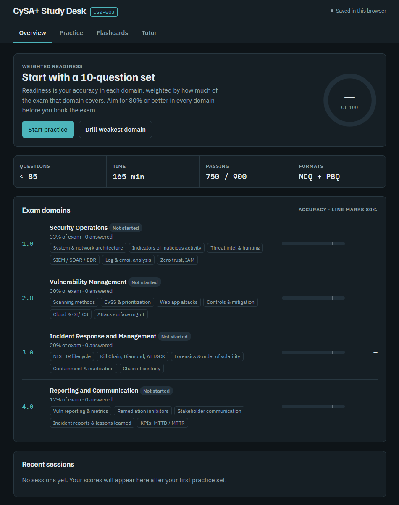
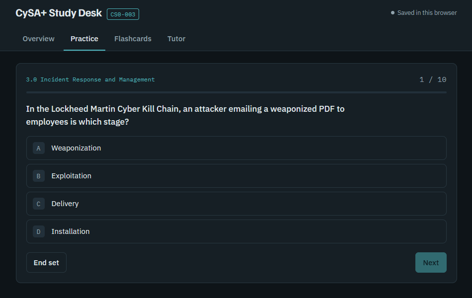
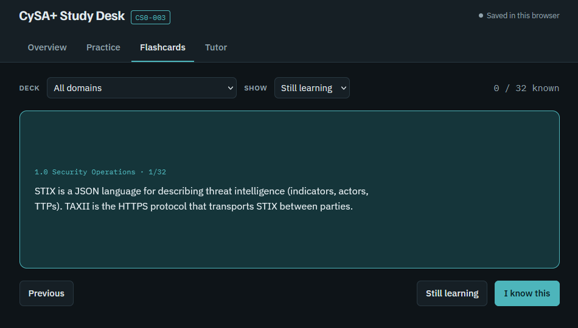
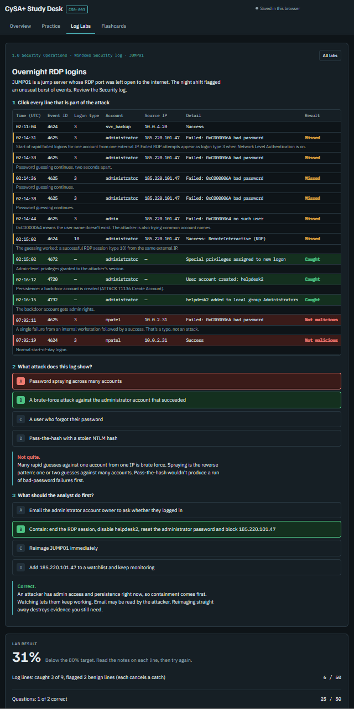
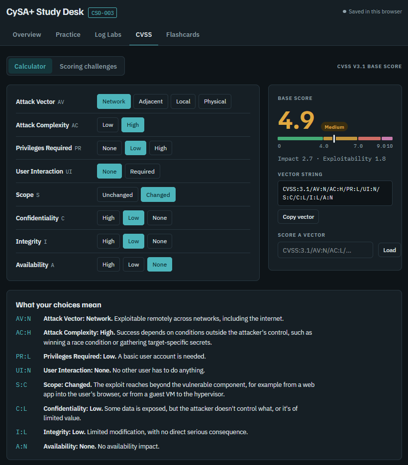
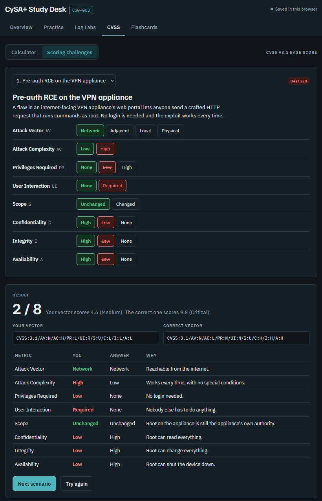

# CySA+ Study Desk

A study app for the **CompTIA CySA+ (CS0-003)** exam, built with [Claude Code](https://claude.com/claude-code).

**Live demo:** https://asyouwish114.github.io/cysa-study-desk/

| Readiness overview | Practice set | Flashcards |
|---|---|---|
|  |  |  |

## Features
- **Readiness overview.** Accuracy in each of the four exam domains, weighted by how much of the exam
  each one covers (33 / 30 / 20 / 17%), with your weakest domain flagged. Log labs count toward their
  own domain and CVSS challenges toward Vulnerability Management, each as one answer scored by your
  latest try.
- **Practice sets.** 40 scenario-based questions with explanations. Filter by domain, retry the ones you
  missed, or practice only the ones you haven't seen. Draws from all domains follow the exam weighting.
  Answer with the A-D or 1-4 keys.
- **Log analysis labs.** Six performance-based investigations (RDP brute force, password spraying,
  C2 beaconing, SQL injection, PsExec lateral movement, Kerberoasting). Flag the malicious lines in realistic logs, identify
  the attack and choose the response, then get graded with a note on every line and an ATT&CK-referenced debrief.

  

- **CVSS v3.1 calculator and scoring challenges.** Build a vector metric by metric and get a live base score,
  severity, sub-scores and a plain-language meaning for each choice, or paste a vector to score it. Then score
  eight realistic vulnerability scenarios and get graded metric by metric with the reasoning. The scoring engine
  follows the FIRST specification, including its rounding rules, and is unit-tested against published scores.

  | Calculator | Graded challenge |
  |---|---|
  |  |  |

- **Flashcards.** 32 cards on key terms, ports, frameworks and metrics, each marked "known" or "still learning".
- **AI tutor and question generator.** Available when the page is hosted as a claude.ai artifact.
  Elsewhere the Tutor tab and AI buttons are hidden.
- Light and dark themes, a mobile layout, and progress saved in the browser.

## Run it
No install and no build. Open `index.html` in a browser, or serve the folder with any static host
(GitHub Pages works as-is).

Development checks (requires Node 18+, no dependencies to install):
```sh
npm run validate   # schema and consistency checks for all study data
npm test           # unit tests for the CVSS scoring engine
npm run check      # both
```

## Project structure
```
index.html              page markup
css/styles.css          design tokens (light + dark) and layout
js/app.js               app logic: state, practice, labs, CVSS, flashcards, tutor
js/cvss.js              CVSS v3.1 scoring engine (no DOM, shared by the app and tests)
data/domains.js         exam domains and weights
data/questions.js       question bank
data/flashcards.js      flashcards
data/labs.js            log analysis labs
data/cvss.js            CVSS scoring scenarios
scripts/validate-data.mjs   schema and consistency checks
tests/                  unit tests (node --test)
.github/workflows/      GitHub Actions: validation and tests on every push and PR
.claude/                Claude Code project configuration (see below)
CLAUDE.md               project guide that Claude Code reads every session
```

## How I used Claude Code
This project is also a demonstration of an AI-assisted development workflow:

- **Prototype to project.** I started with a single-file prototype built as a claude.ai artifact, then
  used Claude Code to restructure it into a maintainable static site, with data separated from logic
  and a validator plus CI.
- **`CLAUDE.md`** records the architecture, data rules and conventions, so every Claude Code session
  starts with the same context and follows the same rules.
- **Custom skills** in `.claude/skills/` are repeatable workflows for growing the content. `add-questions`
  finds coverage gaps in a domain and writes exam-style questions to a defined standard. `add-lab` designs
  a new log investigation with realistic event IDs, benign distractors and ATT&CK-mapped notes. Both
  finish by validating their output.
- **A hook** (`.claude/settings.json`) runs the data validator automatically whenever Claude edits a
  file under `data/`. A broken question gets caught and fixed in the same turn.
- **Tests as a contract.** The CVSS engine is checked against published scores, so AI-written scoring
  logic has to prove itself. CI runs the validator and the tests on every push, so the guardrails apply to
  human and AI changes alike.

## Disclaimer
This is an independent study aid. It is not affiliated with or endorsed by CompTIA. Exam details reflect
CS0-003; check CompTIA's current exam objectives before you test.
